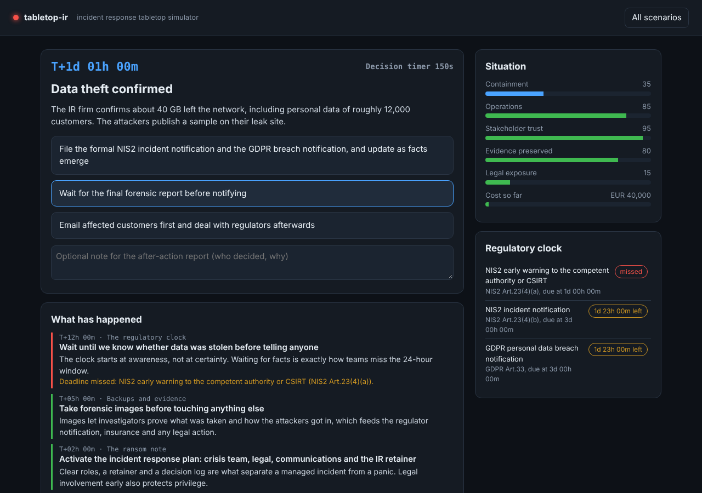
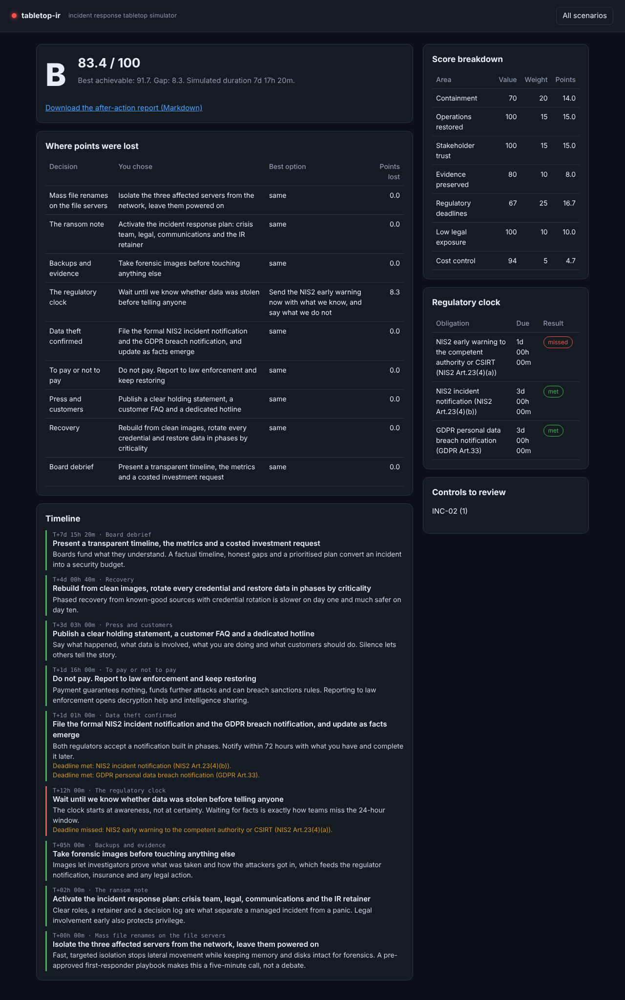

# tabletop-ir

Incident response tabletop simulator. Run a ransomware or business email compromise incident from the first alert to the board debrief. Every decision moves a simulated clock, NIS2 and GDPR deadlines keep running, and the after-action report compares your choices with the best possible path, found by exhaustive search.

Zero runtime dependencies. TypeScript, Node 20+. Loopback only.



## Why

Most tabletop exercises end with "that was useful" and no evidence of what changed. Here each decision has a cost in containment, operations, trust, evidence, legal exposure and money, and the report shows exactly which decision lost the most points and which controls it relates to.

## Run it

```bash
npm install
npm start            # http://127.0.0.1:8700
npm test             # 41 tests
node dist/src/cli.js list
node dist/src/cli.js optimal ransomware-friday
node dist/src/cli.js validate my-scenario.json
```

## What you get

- **Ransomware on a Friday evening**: 9 scenes over 8 simulated days, early warning at 24h, notification at 72h (NIS2 Art. 23, GDPR Art. 33), ransom decision, press, recovery, board debrief.
- **The urgent wire request**: short business email compromise exercise.
- **Simulated clock**: each option takes minutes, scenes can jump the clock forward, deadlines resolve as met, late or missed.
- **Decision timer** per scene; when it expires the scene's default option is taken.
- **Branching with memory**: flags set by earlier choices unlock or hide options and trigger modifiers (restoring into a network that was never isolated is punished).
- **After-action report**: score breakdown, deadline table, timeline with the reasoning behind every choice, points lost per decision against the optimum, controls to review, Markdown download.



## Scoring

| Area | Weight |
|---|---:|
| Containment | 20 |
| Operations restored | 15 |
| Stakeholder trust | 15 |
| Evidence preserved | 10 |
| Regulatory deadlines met | 25 |
| Low legal exposure | 10 |
| Cost control | 5 |

Grades: A from 85, B from 70, C from 55.

The optimum is an exhaustive depth-first search over every reachable path (the scenario graph is a DAG, so it terminates), with a visit budget and a `truncated` flag. The per-decision "points lost" is the difference between the best score still reachable after your choice and after the best choice.

## Write your own scenario

Scenarios are JSON files in `scenarios/`. See `src/types.ts` for the shape and `node dist/src/cli.js validate file.json`. The validator rejects dangling references, duplicate ids, loops, unknown variables, and over-long text.

```json
{ "id": "choice-id", "label": "What the team does", "minutes": 30,
  "effects": { "containment": 20, "cost": 15000 },
  "set": ["flag_name"], "next": "next-scene",
  "visibleWhen": { "none": ["authority_notified"] },
  "modifiers": [{ "when": { "vars": [{ "name": "containment", "op": "<", "value": 60 }] }, "effects": { "operations": -40 }, "text": "The attackers return." }],
  "insight": { "quality": "good", "text": "Why this is right or wrong.", "controls": ["INC-01"] } }
```

## Security

Binds to 127.0.0.1 only. Host header check against DNS rebinding, custom request header plus `application/json` plus same-origin Origin on every POST, 8 KB body limit, strict CSP with no inline script or style, DOM built with `textContent` only. Players never receive the quality of unchosen options. Tests enforce these properties.

## Notes

The scenarios are fictional. Regulatory references are a training aid, not legal advice: check the national transposition of NIS2 and your supervisory authority's rules. Control IDs match the catalogue in [compliance-atlas](https://github.com/jvch0512/compliance-atlas).

MIT licensed.
